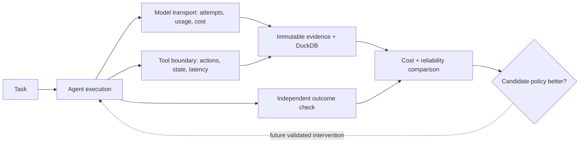

# MELIOR
### Making AI agents more efficient—without confusing cheaper execution with better execution.

**AI-agent systems · Experimental engineering · Optimization under reliability constraints**

> **Research question:** Can we change how an AI agent uses models, tools, context, and retries so that an entire task costs less **while preserving the probability of success**?

Most agent benchmarks ask whether the agent finished. Most cost dashboards count tokens. **Melior connects the two**: observe an agent's execution, account for attempts and failures, evaluate its output independently, then test whether a safer execution strategy is actually better.

I started Melior to investigate an idea borrowed from database systems: *an execution plan can often be improved without changing the task*. With language-model agents, however, changed plans can affect not just cost but output quality and side effects. That turns optimization into an experimental question rather than a simple caching trick.

**Research and engineering work:** execution tracing, immutable evidence, DuckDB-based experiment records, budget-aware model transport, deterministic benchmarks, restricted read reuse, and an offline-verified integration with the external `mini-SWE-agent` coding agent.

## Selected engineering evidence

| Milestone | Observed result | Context |
| :-- | :-- | :-- |
| **Regression verification** | **338 tests passed** | Last recorded offline/cloud-preparation checkpoint, September 2026 |
| **Deterministic baseline** | **60/60 successful tasks** | Internal synthetic benchmark; 120 model and 240 tool operations |
| **Restricted optimization** | **21.39% less simulated cost per successful task** | Specifically engineered workload with eligible repeated reads; *not* a real-agent savings claim |
| **External agent integration** | **Matched instrumented and uninstrumented trajectories** | Controlled offline `mini-SWE-agent` fixture: identical serialized requests, actions and submission |
| **Negative result** | **0 eligible duplicate reads** in the original 60-task baseline | The narrow optimization did not help that natural-to-the-test workload |

The figures above come from retained development/verification records. This public repository includes an independently runnable **small companion simulator** and technical write-ups; the full historical implementation and private run artifacts are **not** bundled. See [checkpoint evidence](docs/historical-results.md) for dates and scope.

## The problem I am tackling

A coding agent may call an LLM, inspect files, run commands, retry, and produce a patch. Each step costs time and resources; many steps are necessary, but some may be redundant. Saving one call is not a useful improvement if it makes the patch fail.

The quantity that matters is **cost per successful task**, counting *all* attempted tasks—including failures:

$$
\text{Cost per success}=\frac{\text{Total execution cost across attempts}}{\text{Number of successful tasks}}
$$

For future decision policies, a useful mathematical objective is

$$
\min_{\pi}\;\frac{\mathbb{E}[C(\pi)]}{\Pr(\text{success}\mid\pi)}
\quad\text{subject to}\quad
\Pr(\text{success}\mid\pi)\geq\Pr(\text{success}\mid\pi_0)-\varepsilon.
$$

Here `π` is an execution policy, `π₀` is the baseline, and `ε` is the tolerated decrease in success probability. This is **a research target**, not an already trained or solved policy. Reliability, latency and safety need to be measured separately.

## What I engineered and investigated

| Research/engineering decision | Why it matters |
| :-- | :-- |
| **Instrument model and tool boundaries** | Capturing only tokens misses tool actions, retries, failures and their causal sequence. |
| **Durable attempts + budget reservations before dispatch** | A timed-out request may still incur a charge; unknown cost must not be silently treated as zero. |
| **Immutable experiment evidence and replay** | Enables controlled comparison without confusing replayed, estimated and newly billed cost. |
| **Independent outcome evaluation** | An agent declaring a task complete is not evidence the answer or software patch was correct. |
| **Restricted repeated-read elimination** | Safe optimization starts with operations whose state and side-effect assumptions can be tested. |
| **External-agent fixture equivalence** | A measurement layer must first establish that its instrumentation does not change the agent being observed. |



**The most important finding was a negative one.** Exact read reuse helped the engineered duplicate-read workload, but not the original baseline, where no matching repeats existed. It meant that optimizing synthetic opportunities was not enough; the next research step must measure inefficiencies in real external-agent traces before choosing an intervention.

## Run the public experiment (under 60 seconds)

This repository contains a self-contained, no-dependency demonstration of one narrow mechanism: safely reusing identical read-only operations while invalidating prior reads after a state mutation.

```bash
python -m unittest discover -s tests -v
python -m experiments.public_demo
python -m experiments.public_demo --json > reports/public-demo-results.json
```

The simulator runs **two controls**: a unique-read workload (where optimization should not help) and a constructed repeat-read workload (where it can). An independent reference interpreter checks outputs and final state. There are **no paid model calls, cloud operations or external agents** in this public demo.

**Start here:** [`experiments/public_demo.py`](experiments/public_demo.py) · [`tests/test_public_demo.py`](tests/test_public_demo.py) · [generated report](reports/public-demo-results.json) · [experiment protocol](docs/experiment-design.md)

The companion demo is a fresh, simplified example of the mechanism—not the original implementation that generated the historical results. Its synthetic numbers must not be conflated with Melior's September checkpoints.

## Technical deep dive

- **[Architecture and trust boundaries](docs/architecture.md)** — data flows, usage accounting, sandbox separation, unknown-charge handling.
- **[Research decisions](docs/technical-decisions.md)** — hypotheses, trade-offs, negative results and the tests they motivate.
- **[Historical engineering results](docs/historical-results.md)** — versions, checkpoints, 60-task baseline and engineered optimization scenario.
- **[Experiment design](docs/experiment-design.md)** — paired controls, reproducibility, success constraints, falsification.
- **[Engineering contributions](docs/contributions.md)** — my role, technical decisions and the evidence behind the project.
- **[Limitations](docs/limitations.md)** — a clear boundary between what works offline and what remains a research question.

## Current research frontier

The original work has a tested **measurement and experimentation foundation**. It does **not** yet establish reduced costs on real external agents. Next steps:

1. Obtain a genuine, evaluated `mini-SWE-agent` baseline with bounded live infrastructure and an independently graded patch.
2. Inspect real traces for recurring overhead and choose a **measured** bottleneck, not a conveniently engineered one.
3. Run baseline-versus-intervention experiments on preselected tasks; report task success, total cost, latency and failure modes.
4. Investigate adaptive policies—routing, stopping, context selection, or workflow search—only when the evidence supports them.

**This is the kind of problem I want to work on in research:** systems that make decisions under uncertainty, rigorous evaluation of intelligent agents, and optimization that holds up beyond a synthetic demo.

---

*Research project by the Melior founder. Historical claims are scoped to recorded checkpoints; the public code is a small reproducible companion, not the complete private runtime. For a 90-second review, see [the reviewer guide](docs/reviewer-guide.md).*
