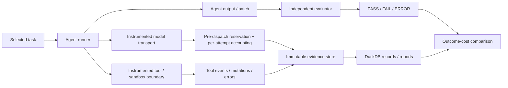

# Architecture and engineering design

This page describes the **historical private design** and its trust boundaries. The runnable demonstration in this repo is smaller and does not implement production provider integration.

## Data flow



## Why the instrumentation boundary matters

Instrumenting only the model API does not reveal tool actions or shell commands. Instrumenting only a tool adapter can miss model retries or token accounting. The design therefore gathers **complementary evidence** with known visibility limits.

A physical attempt is not the same as a logical model query; SDK retries may produce multiple billable attempts. Missing costs and unknown charges must remain unknown, **not zero**.

## Controls reported from the private codebase

- Budget reservations are made **before** provider dispatch.
- Known charges and potential post-dispatch liabilities remain in the record even after timeouts or failures.
- Replay does not silently trigger new provider calls and does not claim new monetary savings.
- The agent sandbox is treated as untrusted and must not receive provider keys or hidden evaluator answers.
- Cloud actions require explicit authorization; the previous verified tests used mocked cloud constructors and blocked real network access.
- Side-effectful actions must never be cached merely because their arguments are repeated.

## Historical source-tree landmarks (not present in this starter)

```text
src/agent_optimizer/
  external/                 # observed mini-SWE-agent integration
    runner.py               # pinned agent execution path
    transport.py            # model request observation
    evidence.py             # immutable execution evidence
    sandbox.py              # isolated environment boundary
    cloud.py                # cloud integration (previously tested offline)
  model_bridge.py           # provider bridge
  budget.py                 # cost and reservation controls
docs/
  verification-phase5b.md
  verification-cloud-preparation.md
experiments/                 # benchmark records (mostly private)
tests/                       # regression suite
```

Before releasing any actual original files, verify names against the current private tree, attribution and licenses, strip secrets, and audit the entire *new* public Git history. Do not copy `private/`, raw recordings or credentials.
